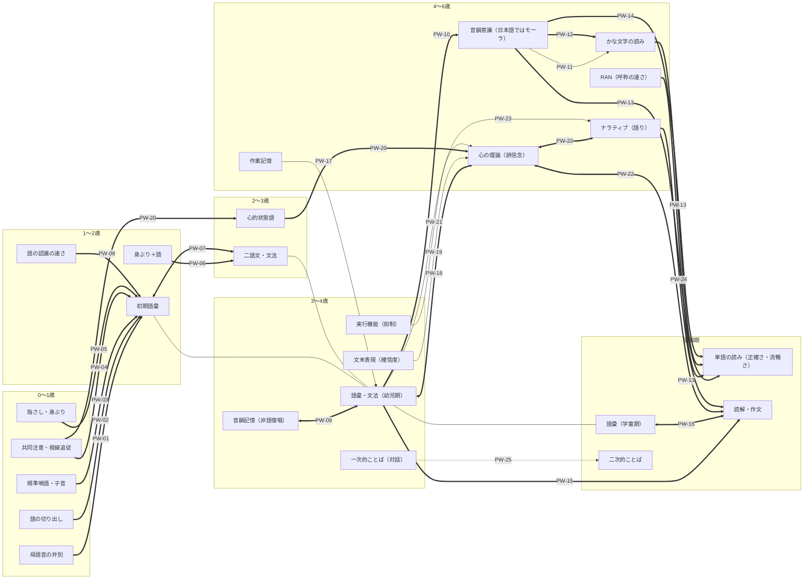

# 03 発達の道筋（基礎 → 上位）

どの下位スキルが、どの上位スキルの基礎になっているかを、根拠の強さつきでまとめた構造ノートです。
神経発達症の子どもでは、この順序がゆっくり進んだり、下位スキルが不十分なまま上位スキルを部分的に身につけたりしますが、
下位スキルが基礎であることに変わりはありません（各ノートの「神経発達症の子どもでの注意」を参照）。

図の矢印の番号は道筋ノート（PW-xx）です。矢印のない細い線は、同じ力が年齢とともに伸びていくことを示します（根拠の辺ではありません）。

根拠の強さ：**縦断で予測**（先に測った力が後の力を予測）／**介入で確認**（下位を育てると上位が伸びた）／**相関のみ**／**理論上の仮説**

## つながりの一覧

- [[PW-01|母語音の弁別（音声知覚） → 語の理解・表出、句の理解（初期語彙）]]〔縦断で予測〕（6か月／7.5か月 → 13・16・24か月（〜2歳半））
- [[PW-02|連続音声からの語の切り出し（分節化） → 表出語彙（2歳）・就学前の言語能力]]〔縦断で予測〕（12か月未満 → 24か月／4〜6歳）
- [[PW-03|規準喃語・子音レパートリー（音の産出） → 初語（指示的な語使用）・表出語彙]]〔縦断で予測〕（9〜16か月（規準喃語は〜10か月） → 16か月／18・24・30か月）
- [[PW-04|共同注意（応答・始発、視線追従、共同注意場面への参加） → 語彙・初期言語（理解・表出・身ぶり）]]〔縦断で予測〕（9〜18か月 → 15〜24か月）
- [[PW-05|指さし・身ぶり（直示的身ぶり、身ぶりで表す意味の種類） → 表出語彙]]〔縦断で予測〕（10〜18か月（ASD児は30か月） → 24〜42か月（各研究で約1〜2年後））
- [[PW-06|身ぶり＋語の組み合わせ（例：鳥を指さして「ねんね」） → 二語発話・文の複雑さ]]〔縦断で予測〕（14〜18か月頃 → 二語期／42か月）
- [[PW-07|表出語彙量（臨界量） → 文法（語連鎖・形態の過剰規則化）]]〔縦断で予測〕（双方向）（1歳4か月〜3歳 → 1歳4か月〜3歳）
- [[PW-08|語の認識の速さ（処理効率） → 語彙の伸び・文法、のちの言語・認知]]〔縦断で予測〕（18か月／25か月 → 30か月まで／8歳）
- [[PW-09|音韻記憶（非語復唱） → 語彙の習得]]〔縦断で予測〕（双方向）（4歳 → 5歳（〜8歳））
- [[PW-10|語彙の増加（語彙表象の再構造化） → 音韻意識]]〔縦断で予測〕（幼児期〜就学初期（抄録に年齢記載なし） → 1年後）
- [[PW-11|モーラ意識（分解・抽出・削除・逆唱） → かな文字の読み（文字音の知識・短文の読解）]]〔相関のみ〕（3〜6歳 → 3〜6歳（同時点））
- [[PW-12|モーラ意識 → かな単語の読解（読んで意味がわかること）]]〔介入で確認〕（学齢（知的障害児1名） → 訓練後）
- [[PW-13|音韻意識・RAN（呼称の速さ）・文字音知識 → 単語の読み（正確さ・流暢さ）・綴り]]〔縦断で予測〕（読み指導の開始時（小1はじめ） → 10か月後〜小2）
- [[PW-14|音素意識・文字音知識 → 単語の読み・綴り]]〔介入で確認〕（就学初期（抄録に年齢記載なし） → 介入終了5か月後）
- [[PW-15|話しことばの理解（語彙・文法・聴解） → 読解（読んで理解すること）]]〔縦断で予測〕（3歳〜就学前 → 小1〜小3）
- [[PW-16|語彙（学童期） → 読解]]〔縦断で予測〕（双方向）（小1・小3 → 小3・小5）
- [[PW-17|作業記憶（＋語彙） → 聴解（文・談話の理解）]]〔相関のみ〕（年長〜小1／25か月 → 年長〜小1／8歳）
- [[PW-18|言語能力（統語・意味、補文構造、視点を切り替える会話） → 心の理論（誤信念の理解）]]〔介入で確認〕（双方向）（3〜4歳 → 3〜5歳（7か月後／訓練後））
- [[PW-19|話し手の確信度を表す文末表現（日本語の助詞）の処理 → 誤信念の推論]]〔相関のみ〕（3歳 → 3歳（同時点の実験））
- [[PW-20|視線追従（乳児期）→心的状態語 → 心の理論（明示的な課題）]]〔縦断で予測〕（10.5か月／2.5歳 → 2.5歳／4.5歳）
- [[PW-21|実行機能（抑制制御） → 心の理論]]〔相関のみ〕（3〜4歳 → 3〜4歳（同時点））
- [[PW-22|心の理論 → ナラティブ・文章の理解（聴解・読解）]]〔縦断で予測〕（双方向）（3歳〜（メタ分析は3〜70歳、平均10.5歳） → 同上）
- [[PW-23|語彙・文法（下位の言語スキル） → ナラティブ（語りの力）]]〔相関のみ〕（3〜6歳／4歳 → 3〜6歳／4・7歳）
- [[PW-24|ナラティブ・説明的な談話（口頭） → 読解・作文]]〔縦断で予測〕（5歳／就学時 → 8歳／12歳以降）
- [[PW-25|一次的ことば（親しい人とのその場の対話） → 二次的ことば（その場を離れ、不特定の聞き手に一方向で語る・書く）]]〔理論上の仮説〕（幼児期 → 就学前後〜学童期）
